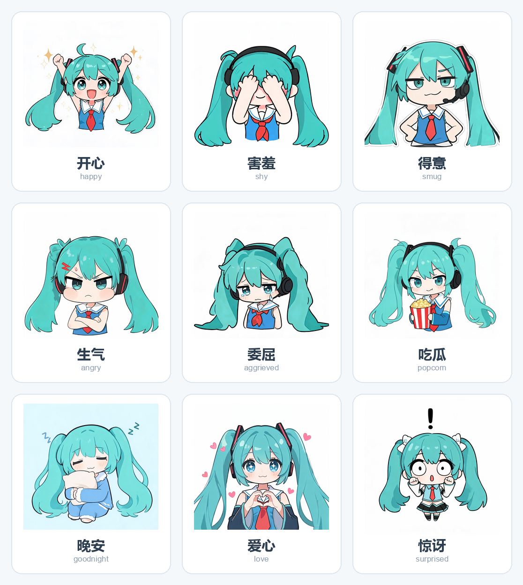

# Magical Miku Bot

**简体中文** | [English](README.en.md)

给 [AstrBot](https://github.com/AstrBotDevs/AstrBot) 用的三个初音未来风格插件，以及一份可直接使用的人格模板。

> **非官方同人项目**。初音未来（Hatsune Miku）为 Crypton Future Media 的角色，本项目与其无任何关联，仅供学习与个人非商业使用。

## 包含内容

| 名称 | 作用 |
|---|---|
| `miku_sticker` | 按情绪发送本地表情包；群里收到的图片可自动分类入库（可选） |
| `miku_image_limit` | 限制单次请求携带的图片数量，避免连续刷图烧 token |
| `miku_greeting` | 每天早安 / 晚安，节日自动彩蛋 |
| `persona/miku_persona_template.md` | 初音未来人格提示词模板，替换占位符即可用 |

## 插件说明

### miku_sticker

人格回复里写 `[表情:开心]`，插件会把标记替换成 `stickers/开心/` 下随机一张图发出去。

- 支持的分类：`开心` `害羞` `得意` `生气` `委屈` `吃瓜` `晚安` `爱心` `惊讶`
- **图片素材不随仓库分发**，请自行准备后放进对应文件夹（`.jpg .png .gif .webp` 均可）
- 目录为空时标记会被静默删除，不会报错
- 可选功能：在指定群里自动收集图片，用视觉模型分类入库（默认关闭，见 `ALLOWED_GROUPS` 与插件内开关）

### miku_image_limit

在请求发给模型前裁剪图片：当前消息最多保留 3 张，历史消息中超出部分替换为 `[图片]` 文本占位。适合群聊里有人连刷图片的场景。

### miku_greeting

| 时间窗 | 行为 |
|---|---|
| 08:00–09:29 | 早安 |
| 23:30 之后 | 晚安 |
| 09:00–20:59 | 节日彩蛋（元旦、情人节、3/9、8/31、万圣节、平安夜、圣诞） |

同一天同类只发一次，状态存 `data/state.json`，重启不重复。

## 安装

1. 把 `plugins/` 下三个目录复制到 AstrBot 的插件目录（通常是 `data/plugins/`）
2. 重载插件或在 WebUI 里启用
3. 修改群号：
   - `miku_sticker/main.py` 的 `ALLOWED_GROUPS`
   - `miku_greeting/main.py` 的 `GROUPS`
4. 放入自己的表情素材到 `miku_sticker/stickers/<情绪>/`
5. 人格：打开 `persona/miku_persona_template.md`，把 `---` 之后的内容整段复制到人格的 system_prompt

## 依赖

- AstrBot >= 4.4.0
- `miku_sticker` 的情绪分类需要多模态模型（能看图）；不需要自动收集时可不配

## 成本与安全提醒

- **API Key 由使用者自行提供**，本项目不含任何密钥
- 若把 bot 放进公开群，务必加限流（按用户每日次数、群白名单），否则会被刷屏烧 token
- 不要在仓库中提交 `cmd_config.json`、数据库或任何 token

## 版权说明

- 代码：MIT License
- 表情包素材：**不提供**。如需使用请自行确认来源合法性（官方贴纸、游戏素材属于发行方版权，不建议再分发）
- 角色形象：初音未来 © Crypton Future Media。本项目遵循非商业同人使用的原则，不得用于商业用途，也不得使人误认为官方产品

## License

[MIT](LICENSE)
